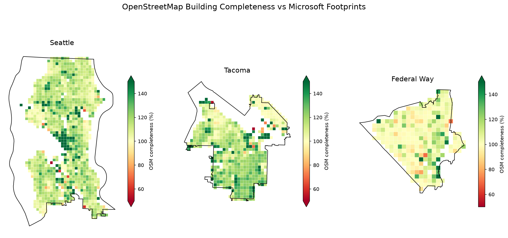

# How Complete Is OpenStreetMap? Buildings in Seattle, Tacoma and Federal Way



## Overview

OpenStreetMap (OSM) is a free, volunteer-built map used by humanitarian groups, apps and governments. How complete is its building data in Puget Sound? This project compares OSM buildings with Microsoft's imagery-based building footprints for Seattle, Tacoma and Federal Way, city by city and across a grid of 1,500-foot squares, then checks the weakest areas by eye.

## Key Findings

| City | OSM buildings | Microsoft buildings | Completeness |
|---|---|---|---|
| Federal Way | 26,311 | 25,565 | **102.9%** |
| Seattle | 215,147 | 186,393 | **115.4%** |
| Tacoma | 95,159 | 81,000 | **117.5%** |

- **OSM building coverage is essentially complete in all three cities.** Each has more OSM buildings than Microsoft detected.
- **Only 12 of 1,923 grid squares (0.6%) scored below 75%**: 6 in Seattle, 4 in Tacoma and 2 in Federal Way.
- **The lowest-scoring squares were port container terminals.** Microsoft's imagery-based detection counts stacked shipping containers as buildings; OSM correctly does not. Visual checks found little or nothing missing from OSM in any low-scoring square.
- **Federal Way is the most even:** its squares cluster tightly around 100%, showing complete coverage with less extra detail than Seattle or Tacoma.
- **Lesson:** a completeness score is only as good as its reference data. Validating flagged areas by eye showed the gaps were errors in the comparison dataset, not in OSM.

## Data

- [OpenStreetMap buildings, Washington State (Geofabrik extract, November 19, 2026)](https://download.geofabrik.de/north-america/us.html)
- [Microsoft US Building Footprints, Washington (released 2018)](https://github.com/microsoft/USBuildingFootprints)
- [U.S. Census Bureau TIGER/Line 2024 Places](https://www2.census.gov/geo/tiger/TIGER2024/PLACE/): city boundaries

The building datasets are not included in this repo because of their size. Download them from the links above and unzip them into `data/` (OSM buildings into `data/osm/`, Microsoft as `data/Washington.geojson`).

## Methods

1. Loaded both building datasets for the study area using a bounding box, so only the needed buildings are read from the state files
2. Reprojected everything to Washington State Plane South, US feet (EPSG:2927)
3. Converted each building to a point inside its footprint and assigned it to a city with a spatial join (a reusable function)
4. Calculated completeness = OSM buildings ÷ Microsoft buildings × 100, by city
5. Built a grid of 1,500-foot squares, counted each dataset's buildings per square, and kept squares with at least 10 Microsoft buildings
6. Mapped completeness by square and visually inspected every square below 75% against the live OSM map

## Tools

Python, GeoPandas, pandas, NumPy, Shapely, matplotlib, folium, JupyterLab, Git

## Limitations

- Microsoft's footprints date from 2018, so newer buildings appear only in OSM, and demolished buildings appear only in Microsoft. Scores above 100% partly reflect this.
- The two datasets draw buildings differently: OSM may map sheds and garages or split townhouses into units, while Microsoft may split or merge large complexes.
- Counts compare the number of buildings, not their shape or position accuracy.

## How to run

```
conda create -n gis -c conda-forge python=3.12 geopandas jupyterlab matplotlib folium
conda activate gis
jupyter lab
```

Download the data (see Data), then open `osm_completeness.ipynb` and choose Run → Run All Cells.

## Related projects

- [South King County Flood Risk Analysis](https://github.com/shaerlimtiaco/south-king-flood-risk) uses the same Microsoft buildings to count flood-exposed structures.
- [Puget Sound Cities](https://github.com/shaerlimtiaco/puget-sound-cities) provides the city boundaries.

## Author

Shae Limtiaco · [GitHub](https://github.com/shaerlimtiaco) · Volunteer mapper with OpenStreetMap and the Humanitarian OpenStreetMap Team (HOT)